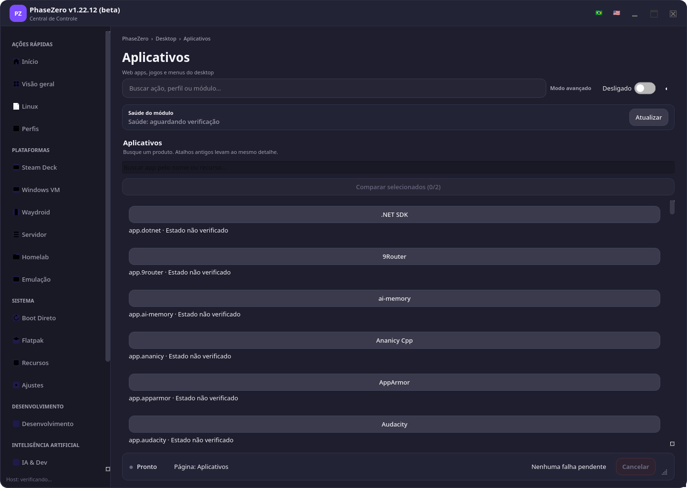
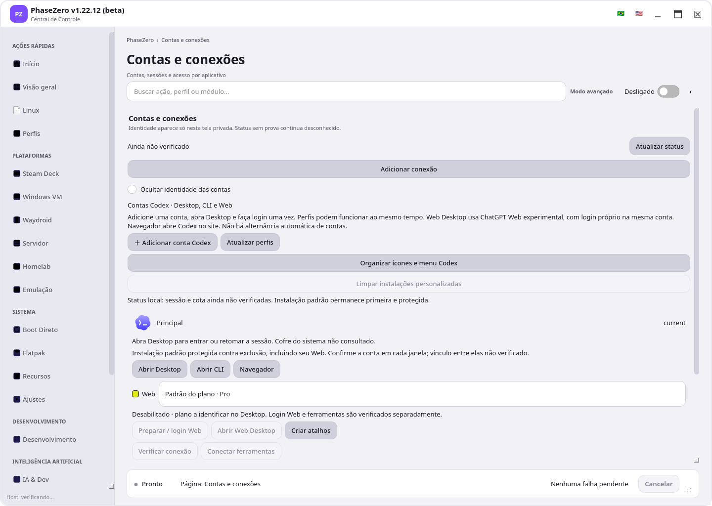
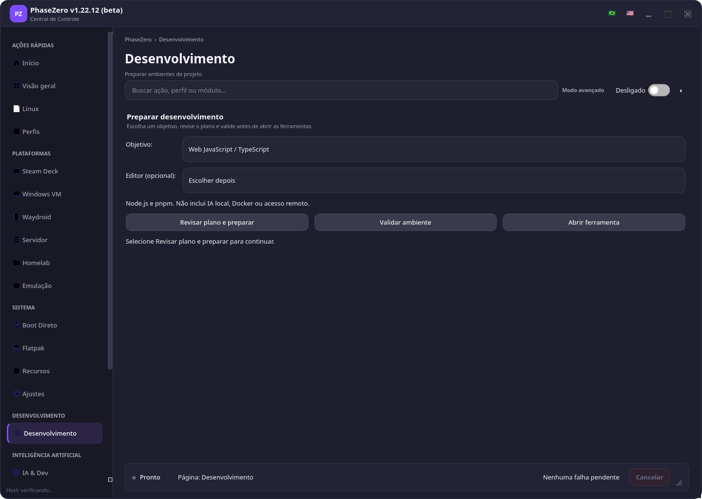
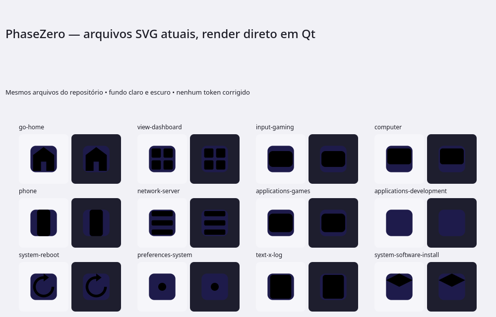
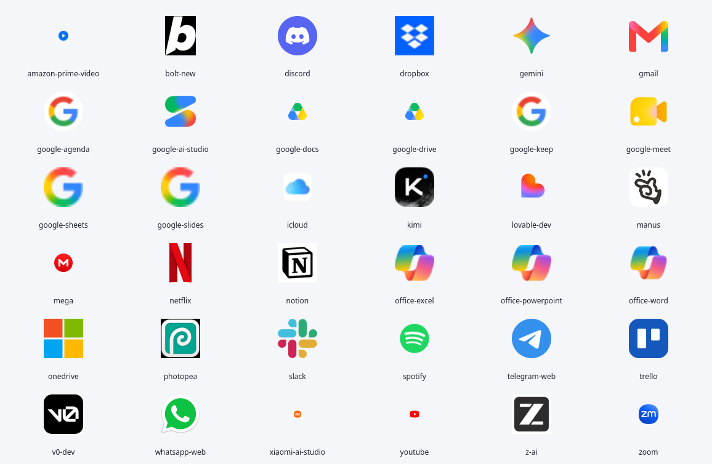

# PhaseZero revisão visual para aprovação

Pedido: qualificar interface, ícones, cores e derivados instalados com acabamento premium. Esta entrega prepara decisão visual e implementação por outro agente. Estado: **proposta, aguardando seleção visual**. Nenhuma mudança funcional, instalação, migração de atalhos ou aplicação de tema integra este lote.

## Mockups para seleção

Três imagens independentes geradas pelo ImageGen integrado, apresentadas nesta ordem. Cada uma explora uma direção e uma tela representativa; não são três versões completas de todas as páginas. Prompts completos e fontes anexadas: [mockup-prompts.json](mockup-prompts.json). Paletas numéricas e medições: [inventory.json](inventory.json).

| Ordem exibida | Imagem | Tela representativa |
|---|---|---|
| 1 | [Mockup 1](mockups/01-obsidiana.png) | Catálogo e detalhe contextual, com amostra de atalhos próprios. |
| 2 | [Mockup 2](mockups/02-porcelana.png) | Conta e canais Desktop/CLI/Web, com família de ícones por canal. |
| 3 | [Mockup 3](mockups/03-grafite.png) | Preparação de desenvolvimento e utilitários instalados. |

Seleção ainda não registrada. É possível escolher uma direção ou combinar elementos após novo refinamento visual. Outro agente implementará somente depois dessa decisão.

Limites para implementação: as imagens movem alguns itens de navegação e usam pictogramas conceituais; preservar grupos/IDs oficiais da matriz abaixo. A área de utilitários demonstra a família visual, não autoriza criar novo catálogo ou página. No mockup 1, substituir a descrição genérica de 9Router por sua finalidade real de roteamento de modelos de IA. No mockup 2, conservar a geometria do asset Codex existente e tratar os marcadores de canal como proposta, sem modificar arte oficial de terceiros. No mockup 3, disponibilidade de validar/abrir depende do estado real, não somente da ordem ilustrada. Não extrair pictogramas finais do raster: preparar assets vetoriais/licenciados e exports conforme contrato.

## Escopo e evidência

Base inicial: `bb0afd7e508ae07afda3c988819a802241430f16`, branch de continuidade `codex/clean-host-dev-bootstrap`, PR #129. Checkout já continha alterações de outra tarefa em contas/Codex e documentação; capturas refletem esse checkout, não uma build imutável do commit. SHA de cada fonte consta no inventário. Data de referência: 2026-11-02.

Inventário cobre 22 páginas registradas da UI nativa, 25 SVGs de categoria, 36 ICOs curados de web apps, marca do pacote, atalhos gerenciados encontrados no host e fontes Windows/WPF/web/TUI. Capturas desta revisão cobrem três páginas e duas pranchas de ícones. Demais telas têm mapeamento de propagação, sem auditoria visual completa nesta rodada.

Capturas Qt offscreen em 1440×1024, escala 100%, HOME/XDG temporários separados em disco persistente. Probes de host, atualização Homelab e recargas foram suprimidos; nenhuma ação de produto foi executada. Estados desconhecidos são intencionais da fixture. Isso permite avaliar desenho e hierarquia; não comprova estado real de conta, serviço, VM, instalação, teclado, touch ou acessibilidade física. Windows/WPF, TUI, web e compositor instalado não foram exercitados visualmente.

Ferramentas: RTK disponível; ai-memory nativo saudável e consultado no projeto. MCP de memória apontou `emulation`; resultados desse escopo foram descartados. Bootstrap `doctor --profile ui`: `ready: true`.

## Achados e impacto

| ID | Prioridade | Evidência | Efeito | Plano |
|---|---|---|---|---|
| VIS-001 | P1 | 25/25 SVGs de categoria contêm `{accent}`/`{muted}`. `scripts/generate_icons.py::icon` não é usado pelo laço; a formatação externa insere `body` sem formatá-lo. | Qt renderiza desenhos pretos, contornos desaparecem e funções distintas parecem quadrados iguais. | Corrigir geração oficial, validar valores de cor e renderizar em claro/escuro. Não corrigir somente cópias instaladas. |
| VIS-002 | P1 | Dez `.desktop` PhaseZero instalados sem `Icon=`. Lista no inventário sanitizado. | Menu de aplicações perde reconhecimento e acabamento da família. | Atualizar geradores oficiais e aplicar migração limitada aos atalhos gerenciados, após aprovação. |
| VIS-003 | P1 | Aplicativos: lista de botões largos sem identidade visual, IDs técnicos como `app.dotnet`, duas buscas e comparação desabilitada proeminente. | Nome, propósito, estado e próxima ação competem; lista não ajuda reconhecer produto. | Uma busca contextual; linhas com logo original, nome, descrição e estado legível; um detalhe e CTA principal. Preservar catálogo/inventário existentes. |
| VIS-004 | P1 | Desenvolvimento: três CTAs de peso visual equivalente. Contas: sequência longa de botões, textos e estados de Web/CLI/Desktop. | Próximo passo pouco evidente; ferramenta, conta e canal se confundem. | Um CTA primário por contexto; ações auxiliares discretas; canal como texto e símbolo próprio, conta como identidade separada. |
| VIS-005 | P2 | Qt: base 13 px, descrições 11 px. Paletas Qt e WPF têm valores diferentes; WPF usa glifos em navegação. | Leitura pequena e estilos divergentes por plataforma/fonte. | Escala base 15 px, secundário 13–14 px; título 28–32 px. Tokens semânticos equivalentes e mesma família de símbolos. |
| VIS-006 | P1 | `text_muted/surface`: escuro 2,67:1, claro 3,40:1. Gate declarado atual passa, mas não inclui esse par. | Texto informativo que usar esse token pode ficar abaixo do piso para texto normal. | Reservar token fraco para decoração/indisponível; texto necessário ≥4,5:1. Ampliar pares efetivamente usados. Não alegar falha WCAG de todo uso sem inspecionar contexto. |
| VIS-007 | P2 | 15/36 ICOs sem quadro exato 256×256; 10/36 sem 16×16. Existem quadros retangulares. | Risco de desfoque ou escala inconsistente em menus/HiDPI. Ausência de tamanho, sozinha, não prova defeito visível. | Inspecionar origem e tamanho real por asset, preservar proporção em canvas quadrado transparente; nunca ampliar favicon pequeno e chamar de alta resolução. |
| VIS-008 | P2 | Marca do pacote usa escudo; cabeçalho usa bloco PZ; atalhos usam família própria, tema do sistema ou ícone genérico. | Identidade fragmentada entre janela, menu e derivados. | Escudo/PZ como núcleo de marca, duas escalas: símbolo funcional plano na UI e ícone de app com profundidade discreta no launcher. |
| VIS-009 | P1 | Prancha dos 36 ICOs: Docs apresenta marca Drive; Word/Excel/PowerPoint apresentam símbolo comum da suíte; Agenda/Keep/Sheets/Slides usam G genérico. | Produtos diferentes deixam de ser distinguíveis pelo desenho. | Curadoria por produto, com fonte oficial e licença. Verificar destino do atalho antes de escolher logo de app ou de suíte. Não basta aumentar resolução. |

### Passo 1 Catálogo de aplicativos

Saúde visual parcial. Busca e catálogo existentes constituem boa base. Logos ausentes na lista, excesso de largura para botões simples e ID técnico como descrição reduzem reconhecimento. Estado de instalação não foi medido nesta fixture.

### Passo 2 Contas e conexões

Saúde visual parcial. Privacidade, instalação protegida e estado sem prova são explícitos. Falta agrupar identidade, superfícies Desktop/CLI/Web e próximos passos; atalhos de gerenciamento recebem destaque semelhante à conexão principal. A captura contém somente conta padrão da fixture.

### Passo 3 Preparar desenvolvimento

Boa estrutura de objetivo e editor opcional. Saúde visual parcial: três botões equivalentes enfraquecem sequência preparar → validar → abrir. Proposta mantém esse fluxo e contratos existentes.

### Passo 4 Ícones atuais

Saúde visual comprometida pelo defeito de geração. Arquivos renderizados diretamente em Qt, sem editar tokens. Tema do desktop pode mascarar defeito ao fornecer outro asset antes do fallback local; essa dependência explica variação entre hosts, mas não foi testada em outro host físico.

### Passo 5 Identidade dos web apps

Saúde visual parcial. Parte da coleção preserva reconhecimento forte, como Gmail, Spotify e Telegram. Outras entradas usam símbolos de suíte ou marcas genéricas que não distinguem produtos. Captura renderiza todos os 36 arquivos curados a 64 px; ícones minúsculos ou desfocados evidenciam necessidade de conferir tamanho óptico e insumo original. Não representa render do Explorer no Windows.

## Direção comum proposta

Acabamento vem de alinhamento, escala óptica, espaço, contraste e hierarquia. Profundidade discreta apenas nos ícones de app. Navegação e estados usam pictogramas planos consistentes, com rótulo visível. Nenhum requisito de blur, shader ou animação contínua no Steam Deck.

| Elemento | Especificação para aprovação |
|---|---|
| Marca | Preservar reconhecimento PhaseZero. Explorar refinamento do escudo/PZ; mudança de símbolo exige seleção visual. |
| Ícones de navegação | Uma biblioteca aberta, versão fixada e licença incluída; grade 24 px; caixas de 20/24 px; espessura uniforme. Não usar SF Symbols como dependência de Linux/Windows. |
| Família de apps PhaseZero | Ícone mestre 1024 px; exports PNG 16/24/32/48/64/128/256/512, SVG de origem e ICO multiquadro. Silhueta comum; glifo e rótulo distinguem função. |
| Apps de terceiros | Logo original de origem oficial/instalada, mantendo cores e proporção. Área óptica 65–75% do slot pode orientar marca própria; respeitar clear space específico de cada marca de terceiro. |
| Contas e canais | Cor identifica conta, nunca prova sessão/cota. Desktop, CLI e Web têm texto e símbolo de canal; indicador de canal externo à arte oficial. Não depender só de cor. |
| Status | Rótulo + símbolo + cor: Não verificado, Instalado, Precisa conectar, Operando, Atenção, Falhou. Instalação, sessão, cota, grant e operação continuam estados distintos. |
| Ações | Um CTA principal, auxiliares neutros; remover ambiguidade entre desabilitado e secundário. Exigir motivo e próximo passo quando indisponível. |
| Tipografia | Inter/Noto Sans no Linux; Segoe UI no Windows. Base 15 px, secundário 13–14 px, heading 28–32 px; metadados 12 px somente quando dispensáveis à decisão. |
| Espaçamento | Base 4 px; ritmo 8/12/16/24/32. Separar por espaço e divisores antes de adicionar cartões e bordas. |
| Interação | Alvos ≥44 px; 48 px nas telas touch/controller. Foco explícito ≥3:1. Hover não substitui foco/seleção. |
| Movimento | Transições 120–180 ms, sem animação informativa contínua; respeitar movimento reduzido. |
| Temas | Sistema, Claro, Escuro e Alto contraste continuam na preferência existente. Variantes conceituais não acrescentam outro seletor de temas. |

Paletas candidatas e contraste calculado constam de `inventory.json`. São propostas; raster gerado não é fonte de verdade de cores ou espaçamentos.

## Propagação para todas as páginas registradas

Manter IDs, catálogo, grupos e fluxos atuais. Nomes abaixo são conceitos semânticos; selecionar asset concreto da biblioteca na implementação.

| Página | Símbolo proposto | Foco da revisão |
|---|---|---|
| Início | Casa | Um objetivo inicial e continuidade; atalhos com identidade consistente. |
| Visão geral | Painel | Saúde por evidência; estado desconhecido não vira sucesso. |
| Perfis | Camadas | Escolha por objetivo com CTA Aplicar; sem toggle de perfil. |
| Linux | Logo da distribuição instalada | Logos reais e fallback local legível. |
| Steam Deck | Controle | Modos exclusivos, foco forte e alvos de 48 px. |
| Windows VM | Monitor | Integridade e ação disponível; risco e boot seguem gates WBR. |
| Waydroid | Smartphone | Sessão Android separada de container e compartilhamentos. |
| Servidor | Servidor | Serviços deste host, sem confundir com outro computador. |
| Homelab | Casa conectada | Host ativo explícito; estados operacionais seguem roadmap próprio. |
| Emulação | Controle com biblioteca | Distinguir de Steam Deck por símbolo/rótulo, sem assets proprietários. |
| Boot Direto | Reiniciar | Destino e risco claros, ação secundária de recuperação. |
| Flatpak | Pacote com instalação | Origem e permissões; sem prometer loja não integrada. |
| Recursos | Extensão | Distinguir capacidade, app e ajuste. |
| Desenvolvimento | Pasta com código | Preparar → validar → abrir; CTA por etapa. |
| Contas e conexões | Chave e usuário | Conta, provedor e canal legíveis; OAuth/cofre existentes. |
| IA & Dev | Assistente | Agentes, runtime, sessão e ferramentas em hierarquia progressiva. |
| Proxies IA | Conexão intermediária | Estado observado e grants; manter superfície avançada aninhada. |
| Roteamento IA | Rede | Consumidor, rota, política e cota; não criar novo gateway. |
| Aplicativos | Grade de apps | Reconhecimento por logo, estado e detalhe contextual. |
| Ajustes | Sliders | Separar ajuste aplicado, recomendado e indisponível. |
| Temas | Paleta | Prévia e Aplicar na preferência oficial, com rollback existente. |
| Resultados | Histórico | Severidade, origem e próxima ação; estado não depende só de cor. |

## Derivados instalados e componentes compartilhados

| Família | Trabalho visual proposto | Owner existente |
|---|---|---|
| PhaseZero Central | Marca única para pacote, janela e menu. | `packaging/linux`, `linux/ui_native/widgets.py` |
| Codex por conta | Arte oficial preservada; identidade de conta consistente; canal Desktop/CLI/Web distinguido por símbolo e texto no contexto. Nada de email dentro do ícone. | `linux/ai/codex_profiles.py`, `linux/ui_native/codex_profiles_panel.py` |
| Contas Codex | Ícone próprio de gerenciamento; diferenciar de app/provedor. | Mesmo gerenciador de perfis; sem novo registry. |
| Reparar entrada/touch/microfone/terminal | Mesma família de ícones de utilidade, cada função com símbolo reconhecível. | `linux/repairs/manager.py` |
| Restaurar controles | Controle com seta de retorno; identidade distinta de entrar no Game Mode. | Backend de entrada Steam Deck existente. |
| Modos portátil/dock monitor/dock TV/dev | Silhueta e rótulo distintos, cor somente auxiliar. | Geradores de desktop entries Steam Deck. |
| Teclado virtual/ditado/atalhos/visão de atividades/reinício | Completar ícones ausentes e padronizar nomes em PT-BR. | Gerador oficial de cada entry; localizar antes de editar. |
| SteamZero | Conferir precedência XDG: entry de usuário usa `phasezero-port-steam`; entry de sistema usa `input-gaming`. Não remover por semelhança de nome. | Instalador/gerador de SteamZero existente. |
| Web apps | Conferir 36 ICOs, canvas/alpha, quadros e origem oficial. | `assets/webapp-icons`, `Resolve-BootstrapWebAppIconLocation` |
| Windows/WPF | Equivalência semântica de cores, símbolos e estados; plataforma continua nativa. | `bootstrap-ui.ps1`, `windows/ai/*-ui.ps1` |
| Web/TUI | Legibilidade, foco e severidade; web continua fallback gerado, TUI somente leitura. | `linux/ui/templates/dashboard.html`, `linux/ui/tui.sh` |

## Referências de badges

Três objetos diferentes: ícone identifica função/app; badge oficial aponta disponibilidade/integração específica; status PhaseZero descreve evidência operacional. Manter cada finalidade clara no plano.

Referência Figma informada retornou HTTP 403; nenhuma camada, arquivo ou conjunto Apple foi importado. A integração Composio Figma está desconectada. A lacuna foi informada e uma pergunta opcional foi apresentada; sem resposta durante a pesquisa, a exploração prosseguiu com a premissa explícita de usar fontes oficiais verificadas, pois o pedido usa badges como inspiração. Não interpretar essa premissa como aprovação do operador nem como acesso ao arquivo Figma. Incorporar essa fonte em refinamento posterior se disponibilizada.

[Apple App Store](https://developer.apple.com/app-store/marketing/guidelines/) orienta proporção, área de respiro, tamanho legível e uso da arte fornecida. Inspiração para PhaseZero: disciplina visual de símbolo + mensagem curta + ação, sem aplicar badge de App Store onde não há distribuição comprovada. Não baixar pacote de 336 MB nesta tarefa.

[Google Identity](https://developers.google.com/identity/branding-guidelines) é referência de **Sign in with Google**, não um pacote do logo Google Play. [Google Play Partner Marketing Hub](https://partnermarketinghub.withgoogle.com/brands/google-play/google-play/lockups-icons-badges/?folder=86718) foi localizado em busca oficial; abertura direta expirou, portanto arte não foi inspecionada. [Steamworks](https://partner.steamgames.com/doc/marketing/branding) e [Samsung](https://developer.samsung.com/galaxy-store/gsb-promotion/manage-your-gsb.html) tratam marcas/badges em seus contextos de publicação.

Wallet, Watch Face, Apple Pay, Health, News, Music/Podcast, Google Assistant/Pay, Wear OS e Cast permanecem referências de linguagem visual. Não existe neste levantamento prova de que tais integrações estejam presentes no PhaseZero. Links genéricos Amazon/Huawei/Samsung não demonstram direito ou elegibilidade de distribuição. Microsoft Store badge exige página atual do programa e destino real antes de uso. Nenhum mock deve sugerir parceria, certificação ou publicação não demonstrada.

## Plano para próximo agente após aprovação

1. **Fixar seleção:** registrar mock escolhido e ajustes; confirmar paleta, tratamento dos ícones e densidade. Imagens são alvo de direção, não contrato de pixel/funcionalidade. Refinar telas adicionais antes de implementar quando escolha exigir mudança estrutural.
2. **Corrigir fundação existente:** VIS-001 no gerador, fallback determinístico e tokens no owner atual. Não adicionar runtime obrigatório QtSvg: instalação mínima Arch já apresentou falha dessa dependência. Usar caminho QIcon existente e raster exportado quando necessário.
3. **Consolidar arte:** subset de biblioteca aberta fixada para navegação; arte própria PhaseZero para launchers; preservar logos de terceiros. Registrar origem, licença, versão, hash e exports, sem criar catálogo paralelo.
4. **Aplicar uma tela piloto:** Aplicativos e seu detalhe, mantendo inventário/runner atuais, logos locais, ações e estados reais. Depois Contas/Desenvolvimento. Expandir às outras 19 páginas pela matriz.
5. **Migrar derivados:** instalar assets via empacotamento/geradores existentes; limitar alteração aos atalhos gerenciados, preservar conta/Exec/grants e customizações. Snapshot e rollback antes de substituir arquivo instalado. Retenção de filhos/ownership de entrada continuam obrigatórios.
6. **Paridade e aceite:** Windows nativo, Linux, fallback e compositor; evidência em cada alvo. Registrar SHA e capturas no handoff existente. Sem merge, release, deploy ou instalação em produção por este plano visual.

## Aceite da futura implementação

- Nenhum token de cor pendente em asset gerado; ícones distinguíveis a 16/20/24 px e em claro/escuro/alto contraste. Validar fallback com tema de desktop ausente.
- Logos oficiais preservados; ausência/offline tem fallback semântico local; nenhum download de marca durante render de tela.
- Dez atalhos hoje sem ícone recebem arte; pacote e geradores convergem. Conta não é diferenciada somente pela cor; Web/CLI/Desktop têm rótulos inequívocos.
- Texto necessário ≥4,5:1 e indicador de controle/foco ≥3:1 sobre superfície real. Gate cobre pares adicionais; disabled é examinado no contexto, sem reaproveitar seu estilo para ação disponível.
- Uma ação primária por etapa; busca e botões funcionam com os sinais reais. Estado instalado, sessão, cota, grant e operação não colapsam num selo verde único.
- 800×600 e 1280×800, escalas 100/150/200%, claro/escuro e alto contraste; sem rolagem horizontal ou CTA cortado; teclado, foco, leitor de tela, touch/controller e movimento reduzido. Fixture não homologa teste físico.
- Gates pertinentes existentes: ícones do hub, acessibilidade, diálogos, navegação, contas, inventário, temas e empacotamento; Windows exige captura/execução nativa. Sem alterar gates WBR/Homelab ou executar VM/containers para validar desenho.

## Continuidade

Entrega atual limitada a três mockups, evidência, inventário e plano visual. Árvore preexistente deve ser preservada. CI da base consultada tinha falha em uma execução `shell-test` e Pester ainda em andamento; nenhum resultado remoto certifica esta proposta. Referências locais, contagens, pares de contraste candidatos e imagens foram conferidos. Próximo passo: registrar seleção do operador e refinamentos antes de implementação.
